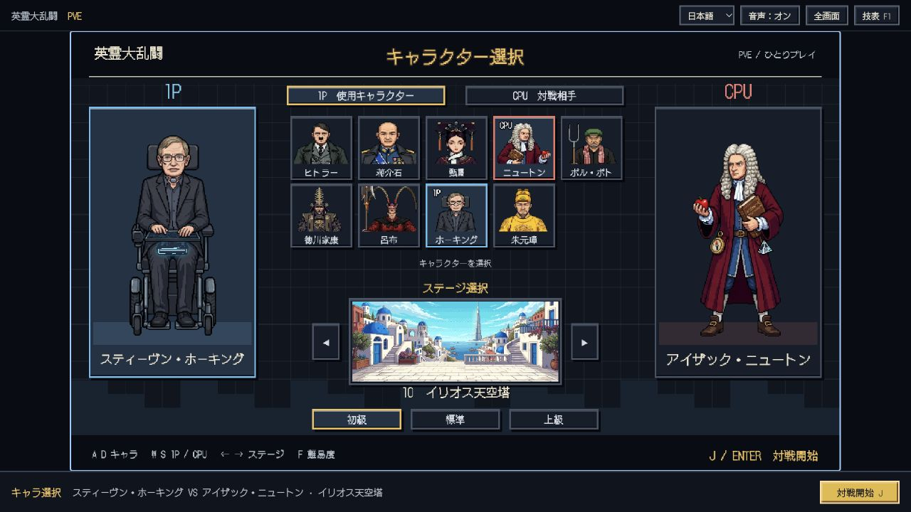
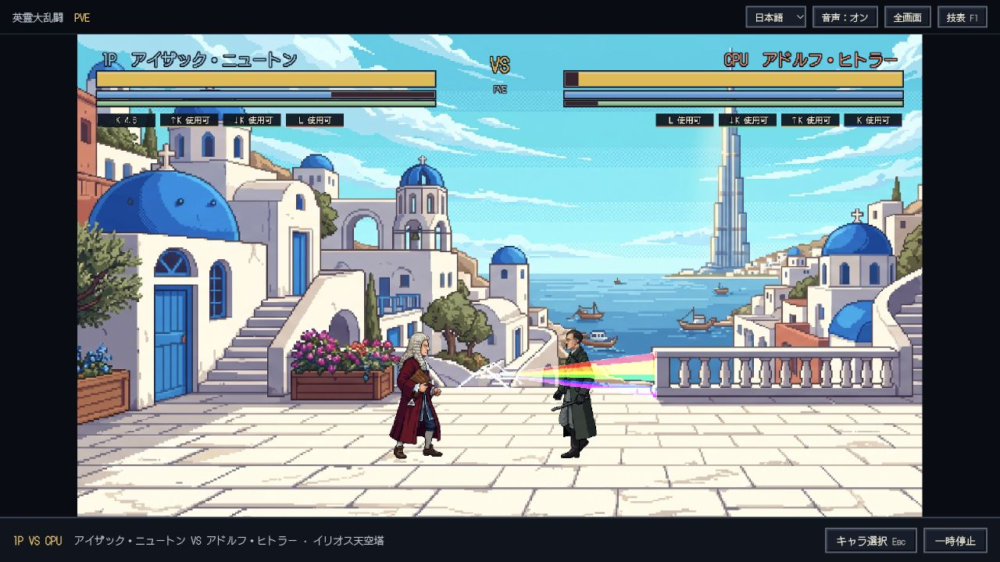
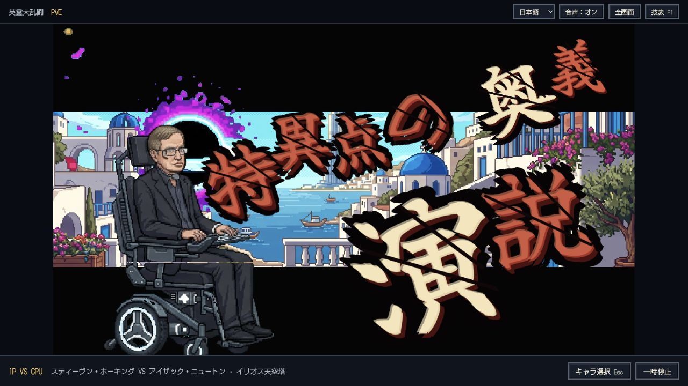
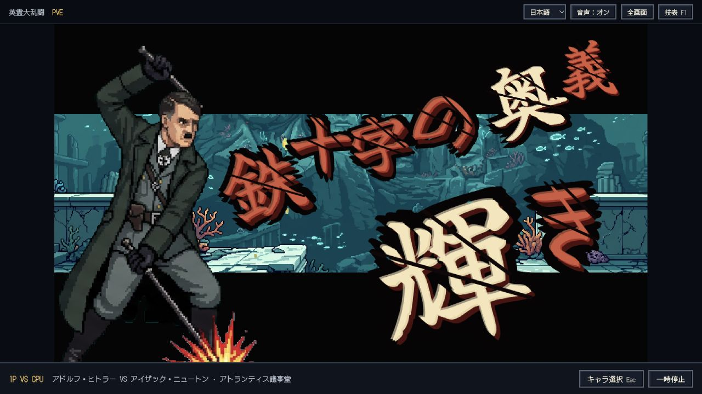
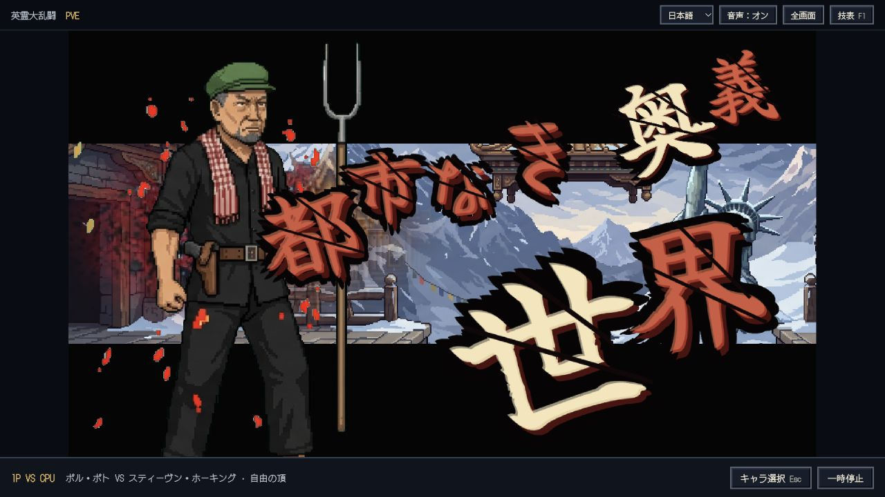
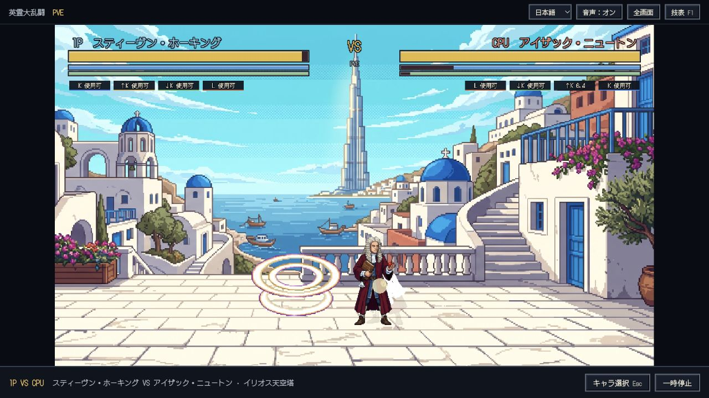
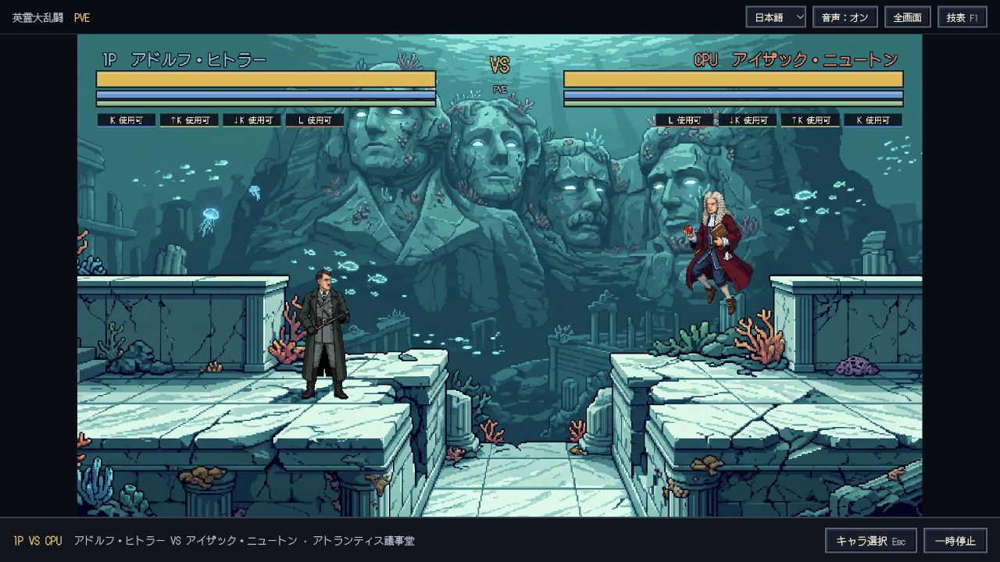
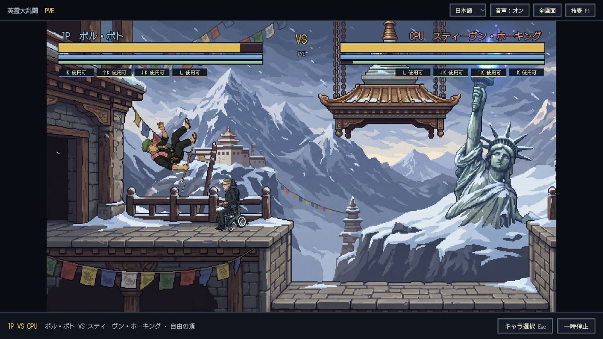

# 英霊大乱闘 · PVE アーケード版

[English](README.md) | **日本語** | [简体中文](README.zh-CN.md)

Phaser 3 で動く、ブラウザー向けのピクセルアート対戦格闘ゲームです。懐かしいアーケード風のキャラクター選択画面から英霊とステージを選び、CPU に挑みましょう。

- プレイヤー対 CPU の PVE。難易度は 3 段階で、同キャラクター同士の対戦も可能。
- 日本語・英語・簡体字中国語に対応。ブラウザーの言語を自動判定し、手動設定も保存。
- 専用の素材スタジオからキャラクターとステージを追加可能。

**[▶ ブラウザーで遊ぶ](https://jayson-sheyue.github.io/herogame/)** — インストール、登録、コマンド操作は不要です。キャラクターを選び、**J / Enter** または **対戦開始** でスタート。パソコンのキーボードが必要です。タッチ操作には対応していません。

## スクリーンショット

日本語 UI と日本語の奥義演出を使った、実際のゲーム画面です。画像をクリックすると原寸で表示できます。

**アーケード風のキャラ選択**：双方のキャラクター、ステージ、CPU の難易度を選べます。



### 必殺技 · K

**ニュートン · スペクトル光線 — イリオス天空塔**



### 奥義 · L

大きな筆文字が角度と大きさを変えながら、キャラクターと戦場を横切ります。

**ホーキング · 特異点の演説**



**ヒトラー · 鉄十字の輝き**



**ポル・ポト · 都市なき世界**



### ピクセルアートの戦場

| イリオス天空塔 | アトランティス議事堂 | 自由の頂 |
| --- | --- | --- |
|  |  |  |

## ローカルで起動する場合

開発や素材追加を行う場合は Python 3.11 以降とパソコンのブラウザーを用意してください。プレイするだけなら Python パッケージや npm のインストールは不要です。

```bash
git clone https://github.com/jayson-sheyue/herogame.git
cd herogame
python3 game/serve.py
```

<http://127.0.0.1:8788> を開きます。終了は `Ctrl+C`。サーバーは標準ではローカルホストのみで待ち受けます。別のポートを使うには `--port 8790` を指定してください。Phaser 3.80.1 は同梱されているため、外部 CDN への接続は不要です。横長の画面とキーボードを推奨します。

## 表示言語

画面上部で **自動 / 日本語 / English / 简体中文** を選べます。初回の標準設定は自動です。ブラウザーの優先言語リストから最初に対応する言語を選びます。`ja` / `ja-JP` は日本語、中国語の各地域設定は簡体字中国語、英語の各地域設定は英語になります。対応言語がない場合や情報を取得できない場合は英語になります。

手動で選んだ言語は保存され、次回も優先されます。**自動** を選び直すとブラウザーに追従します。自動モードでは、ページを開いたままブラウザーの言語設定が変わった場合も更新されます。ブラウザーの言語は端末の設定と異なる場合があります。

キャラクター、ステージ、難易度や進行中の対戦を保ったまま、メニュー、技表、読み込み・エラー表示、内蔵キャラクター名、ステージ名、奥義名を切り替えられます。日本語には専用のドットフォントと筆文字フォントを同梱しています。奥義の演出中に言語を切り替えても、技を最初から再生せず文字だけを描き直します。既存の音声と、素材画像に描き込まれた文字は翻訳しません。

追加パックの `fighter.json` / `stage.json` では、日本語名を `displayNameJa` または `i18n.ja.displayName`、英語名を `displayNameEn` または `i18n.en.displayName` で指定できます。訳名がなければ作者の元の名前を使います。言語切り替えで素材ファイルを書き換えることはありません。ブラウザーで保存が許可されていない場合、選択した言語はそのページを開いている間だけ有効です。

## キャラ選択と対戦開始

- **1P** または **CPU** の立ち絵をクリックして変更する側を選び、中央のキャラクターをクリックします。キーボードでは `W` / `S` で側を切り替え、`A` / `D` でキャラクターを変更します。
- ステージの矢印、または `←` / `→` でステージを変更します。表示されたステージで対戦します。
- **初級 / 標準 / 上級** をクリックするか、`F` で CPU の難易度を切り替えます。
- **対戦開始** をクリックするか、`J` / `Enter` を押します。同キャラクター対戦も可能です。

キャラ選択に戻っても双方の選択とステージは保持され、現在のページ URL にも反映されます。`?p1=`、`?p2=`、`?stage=`、`?diff=` で事前選択できます。旧版の `mode` / `room` パラメーターは削除されます。難易度、音声、表示言語はブラウザーに保存されます。

## 対戦中の操作

| 操作 | キー |
| --- | --- |
| 移動 / ジャンプ・二段ジャンプ / ガード | `A D` / `W` / `S` |
| ダッシュ、被弾中の緊急回避 | `Shift` |
| 通常攻撃 / 対空攻撃 / 下段攻撃 | `J` / `W+J` / `S+J` |
| 必殺技 / 対空必殺技 / 下段必殺技 | `K` / `W+K` / `S+K` |
| 奥義、ダウン・行動不能からの脱出 | `L` |
| キャラ選択へ戻る | `Esc` |
| 決着後、同じ組み合わせで再戦 | `J` / `Enter` または再戦ボタン |

金色は体力、青はエネルギー、緑はスタミナです。必殺技はエネルギー、通常攻撃・ダッシュ・脱出はスタミナを消費します。技の欄にはクールダウンが表示され、**使用可** になれば発動できます。相手を倒すと勝利です。

上部には音声、全画面、**技表**（`F1`）があります。下部から一時停止できます。技表を開くか、ウィンドウから離れると対戦とクールダウンが停止します。技表を閉じるか **対戦を再開** で続けます。素材の読み込みに失敗した場合は、再読み込みかキャラ選択への復帰を選べます。

## 素材パック

[素材スタジオ](https://github.com/jayson-sheyue/herogame-studio) が出力した `.hgpk.zip` をインポートできます。

```bash
python3 game/serve.py --import /path/to/hero.hgpk.zip
python3 game/serve.py --assets /path/to/assets/game
python3 game/import_pack.py /path/to/hero.hgpk.zip
```

`game/incoming/` に置く方法もあります。サーバー起動時に取り込み、成功したパックを `_done/` へ移動します。同じ ID の素材は上書きされます。追加後はゲームのページを再読み込みしてください。`--no-incoming` で自動取り込みを無効にできます。

## Web 公開

`main` への push 後、[GitHub Actions](https://github.com/jayson-sheyue/herogame/actions/workflows/pages.yml) が検証・静的ビルド・GitHub Pages への公開を自動実行します。同じ実行から、itch.io にアップロードできる **herogame-itch-html5** も取得できます。

自分で静的版を作る場合は、リポジトリのルートから次を実行します。

```bash
python3 -m venv .venv
.venv/bin/pip install -r game/requirements-web.txt
.venv/bin/python game/build_web.py
python3 -m http.server 8792 --bind 127.0.0.1 --directory dist
```

<http://127.0.0.1:8792/herogame/> でプレビューします。Windows は `.venv\Scripts\python` / `.venv\Scripts\pip` を使います。出力は `dist/herogame/` と `dist/herogame-itch.zip`。既存の出力は上書きしないため、再ビルドは `--output dist/preview-2` のように新しいディレクトリを指定してください。公開用にはクリーンなチェックアウトを使ってください。ローカルの未追跡素材は出力に含まれません。

itch.io では HTML プロジェクトを作り、`index.html` が直下にある `herogame-itch.zip` をアップロードして **This file will be played in the browser** を選びます。Actions の外側の ZIP は先に展開してください。クリック後に全画面で起動する設定を推奨します。埋め込み表示なら **1344 × 870** を指定できます。キーボードが必要なため、モバイル対応には設定しないでください。公開前に実際の埋め込み画面で動作を確認してください。パッケージの生成だけで itch.io への投稿が完了するわけではありません。

素材の読み込みはネットワークと端末性能に左右されます。一定の秒数での起動を保証するものではありません。詳しい構成は [Web 公開ガイド（英語）](docs/WEB-PUBLISHING.md) と [itch.io 公式仕様](https://itch.io/docs/creators/html5) を参照してください。

## ソースと検証

- `game/src/game.js`：キャラ選択、素材読み込み、PVE 対戦。
- `game/src/i18n.js`：翻訳、表示名、自動言語判定と設定保存。
- `game/src/shell.js` / `game/src/ui.css`：画面枠、操作ボタン、技表、一時停止。
- `game/serve.py`：Python 標準ライブラリのローカル HTTP サーバー。
- `assets/game/`：キャラクター、ステージ、音声。`game/fonts/`：同梱フォント。

開発時の検証には Python に加えて Node.js 22 以降が必要です。npm パッケージは不要です。

```bash
python3 game/check.py
```

[検証記録（英語）](game/tests/README.md) に確認済みの範囲と制約を記載しています。全キャラクターの全技、全ステージの当たり判定、すべての OS・ブラウザーを網羅した検証ではありません。プレイ自体に Node.js は不要です。

ポートが使用中なら `--port` で変更してください。キャラクターが表示されない場合は `assets/game/index.json` と対応する素材を確認します。`index.html` を直接開かず HTTP サーバー経由で起動してください。直接開くと標準のローカルサーバーへ移動します。

インポート用パック、`_bak/`、ローカル設定、認証情報、ビルドキャッシュをコミットしないでください。ゲームのソースは [MIT License](LICENSE)、同梱フォントは[各フォントのライセンス](game/fonts/README.md)に従います。
