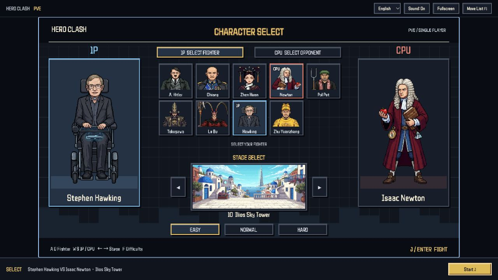
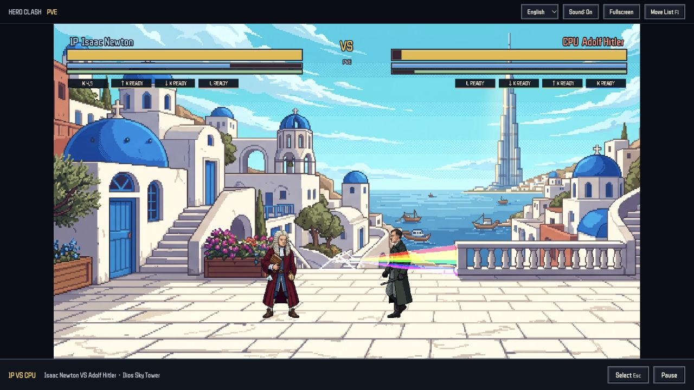
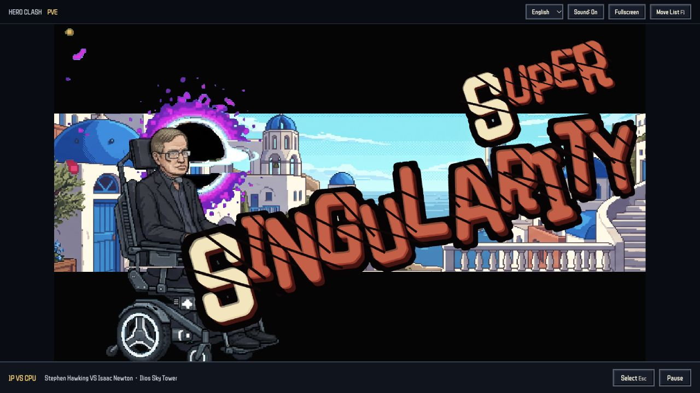
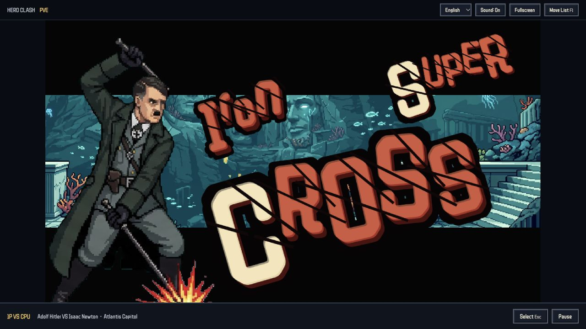
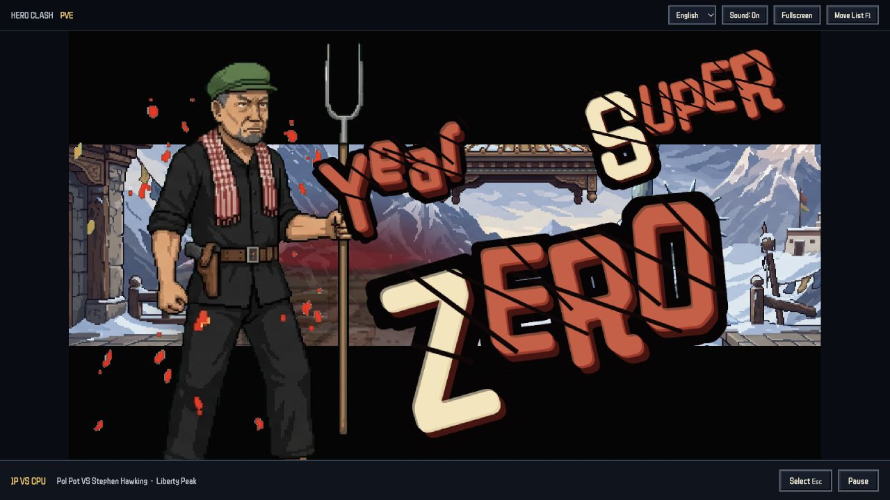
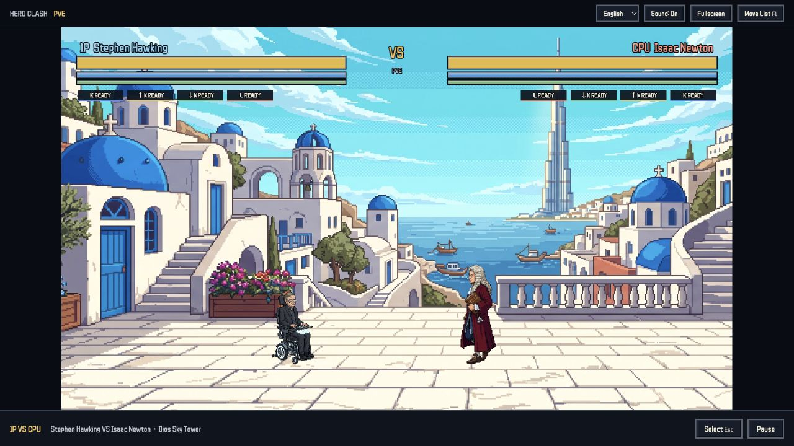
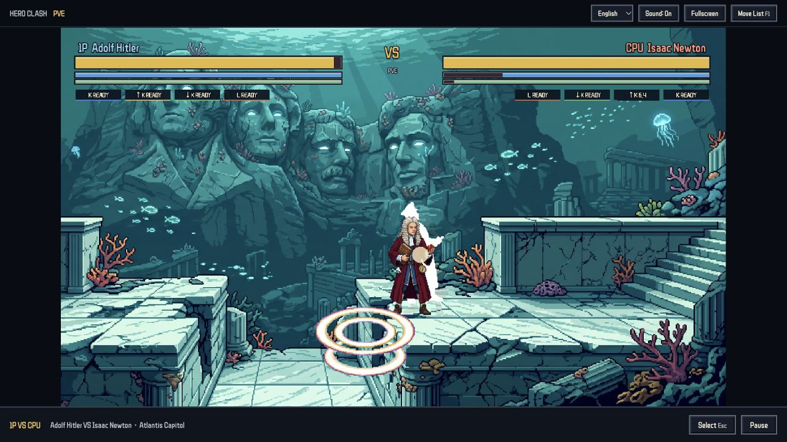
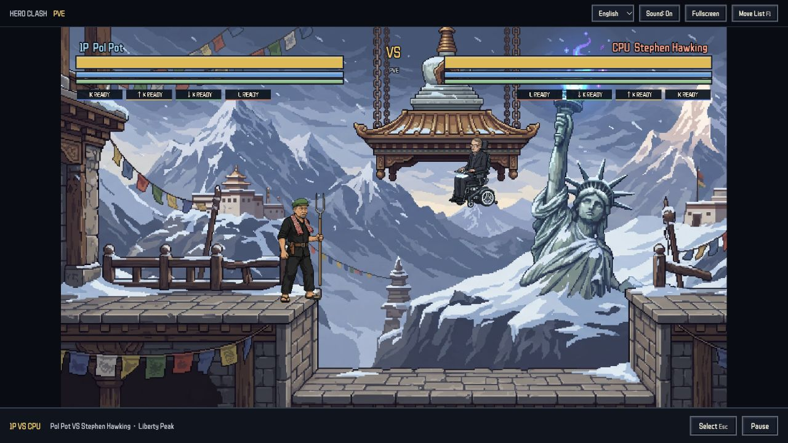

# Hero Clash · PVE Arcade Edition

**English** | [日本語](README.ja.md) | [简体中文](README.zh-CN.md)

A browser-based pixel-art PVE fighting game built with Phaser 3. Pick a fighter and stage, then challenge the CPU through a classic arcade character-select screen and combat HUD.

- Player-versus-CPU fights with three difficulty levels and mirror matches.
- English / Japanese / Chinese interface switching with a saved language preference.
- Importable fighter and stage packs from the companion asset studio.

**[▶ Play in your browser](https://jayson-sheyue.github.io/herogame/)** — no installation, account or command line. Choose a fighter, then press **J / Enter** or click **FIGHT**. Desktop keyboard required; no touch combat controls.

## Screenshots

Real gameplay, captured with the English interface and English super-move effects. Click a picture for the full-size view.

**Classic arcade selection:** pick both fighters, preview the stage and choose the CPU difficulty.



### Skills · K

**Isaac Newton · Spectrum Beam — Ilios Sky Tower**



### Supers · L

Giant, staggered lettering sweeps across the fighter and arena. These super cut-ins are shown at full width.

**Hawking · Singularity**



**Adolf Hitler · Iron Cross**



**Pol Pot · Year Zero**



### Pixel-art arenas

| Ilios Sky Tower | Atlantis Capitol | Liberty Peak |
| --- | --- | --- |
|  |  |  |

## Run locally (optional)

You need Python 3.11+ and a desktop browser. No Python packages or npm dependencies are required to play.

```bash
git clone https://github.com/jayson-sheyue/herogame.git
cd herogame
python3 game/serve.py
```

Open <http://127.0.0.1:8788>. Stop the server with `Ctrl+C`. It binds to localhost by default; use `--port 8790` for another port. Phaser 3.80.1 is bundled locally; no third-party CDN is needed. A physical keyboard and landscape window are recommended; there are no touch combat controls.

## Web publishing

Pushes to `main` run the game checks, build the static game and deploy to GitHub Pages automatically. The same workflow provides a ready-to-upload itch.io HTML5 ZIP. See the [web publishing guide](docs/WEB-PUBLISHING.md) for building, previewing and uploading it.

## Interface language

Choose **Auto** (the default), **English**, **日本語** or **简体中文** from the language selector in the top toolbar. Auto checks the browser’s preferred languages in order: Chinese variants use Simplified Chinese, English variants use English, Japanese variants use Japanese; if none match or language information is unavailable, English is used. Browser preferences usually follow the device language but can be customized in browser settings.

An existing manual choice takes priority and is restored on later visits. Choose **Auto** to resume following the browser; it also responds when browser language preferences change while the page is open. Automatic detection does not save an implicit manual choice.

Switching updates the interface immediately and preserves fighter picks, stage, difficulty and the current fight. Menus, the Move List, loading and error messages, built-in fighter and stage names, and super-move titles have English and Japanese text. Super cut-ins render their carved titles in the selected language, using `SUPER` and English move names with uppercase impact words such as `RAMPAGE` and `SINGULARITY`. Switching during a cut-in repaints its lettering without restarting the move. Japanese cut-ins use Japanese move names and a bundled brush font. Existing voice recordings and text baked into imported artwork remain unchanged.

Imported asset packs may provide `displayNameEn` or `i18n.en.displayName` in `fighter.json` / `stage.json`. For Japanese, use `displayNameJa` or `i18n.ja.displayName`. Without a translation, the original authored name is shown. Source metadata is never rewritten by switching languages. If browser storage is unavailable, language changes work for the current page session.

## Select and start

- Click the **1P** or **CPU** portrait to choose which side to edit, then click a fighter in the center grid. Keyboard: `W` / `S` switches sides; `A` / `D` changes the fighter.
- Use the stage arrows or `←` / `→`. The displayed stage is the one you will play; there is no map lock or random draw.
- Click **EASY / NORMAL / HARD**, or press `F` to cycle CPU difficulty.
- Click **Start** or press `J` / `Enter`. Mirror matches are allowed.

Returning to Select preserves both fighters and the stage, and the current page URL records them. `?p1=`, `?p2=`, `?stage=` and `?diff=` allow preselection. Obsolete `mode` / `room` parameters are removed. Difficulty, sound and language preferences are saved in this browser.

## Combat controls

| Action | Keys |
| --- | --- |
| Move / jump, including double jump / guard | `A D` / `W` / `S` |
| Dash; escape while being hit | `Shift` |
| Attack / up attack / down attack | `J` / `W+J` / `S+J` |
| Skill / up skill / down skill | `K` / `W+K` / `S+K` |
| Super; break free while downed or stunned | `L` |
| Return to Select | `Esc` |
| Rematch with the same fighters and stage after the result | `J` / `Enter`, or the Rematch button |

Gold is health, blue is energy, and green is stamina. Skills consume energy; attacks, dashes and escapes consume stamina. Skill slots show cooldowns; `READY` (English) / `就绪` (Chinese) means available. Knock out the opponent to win.

The top toolbar includes sound, fullscreen and the **Move List** (`F1`). The bottom bar provides Pause. Opening the Move List or leaving the window pauses combat and cooldowns. Close the guide or choose **Resume Fight** to continue. Loading failures provide a reload or return-to-select action.

## Asset packs

Import `.hgpk.zip` files exported by the [asset studio](https://github.com/jayson-sheyue/herogame-studio):

```bash
python3 game/serve.py --import /path/to/hero.hgpk.zip
python3 game/serve.py --assets /path/to/assets/game
python3 game/import_pack.py /path/to/hero.hgpk.zip
```

Alternatively place packs in `game/incoming/`. The server imports them at startup and moves successful imports to `_done/`. Imports overwrite matching IDs. Refresh an existing game page after importing new assets. `--no-incoming` skips automatic imports.

## Source and checks

- `game/src/game.js`: selection, loading and PVE combat.
- `game/src/i18n.js`: translations, asset-name labels and the saved language choice.
- `game/src/shell.js`, `game/src/ui.css`: arcade frame, controls, help and pause.
- `game/serve.py`: standard-library HTTP static server.
- `assets/game/`: fighters, stages and audio; `game/fonts/`: fonts.

Development checks require Node.js 22+ in addition to Python; no npm install is needed:

```bash
python3 game/check.py
```

The [test record](game/tests/README.md) lists the actual verification scope and remaining limits. Playing the game does not require Node.js. Not every fighter move, stage collision, operating system or browser has been exhaustively tested.

If a port is occupied, choose another with `--port`. If selection is empty, check `assets/game/index.json` and the fighter / stage files. Launch through the HTTP server rather than opening `index.html` directly; direct file launches redirect to the default local server.

Do not commit imported packs, `_bak/`, local configuration, credentials or build caches. Source code is licensed under the [MIT License](LICENSE); bundled fonts retain [their own licenses](game/fonts/README.md).
