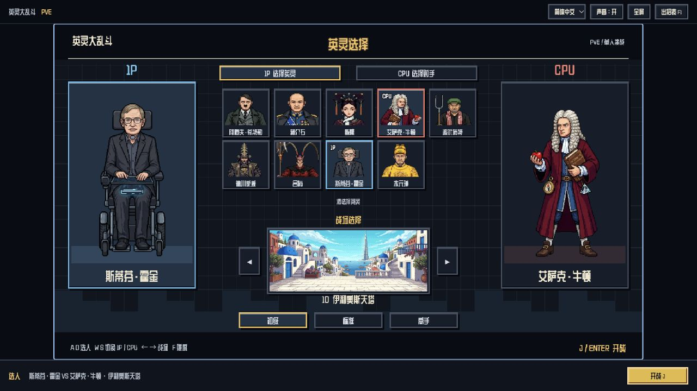
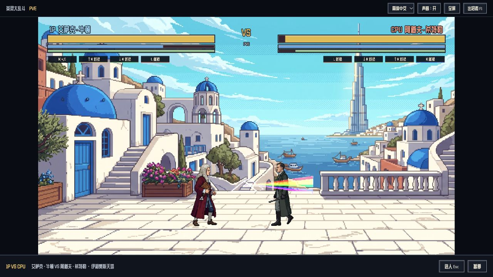
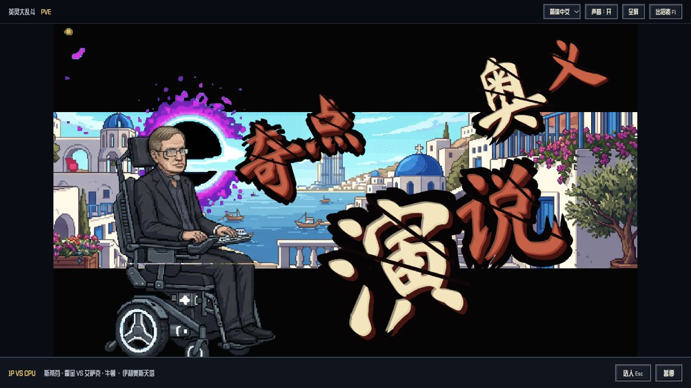
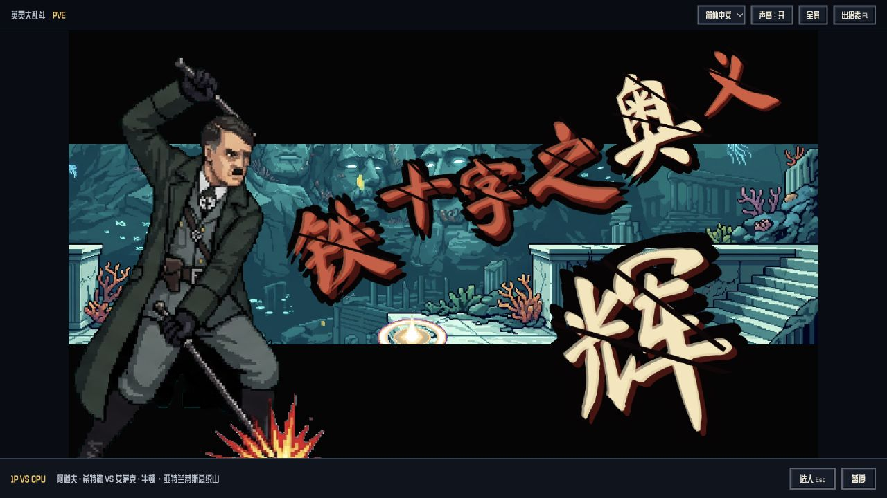
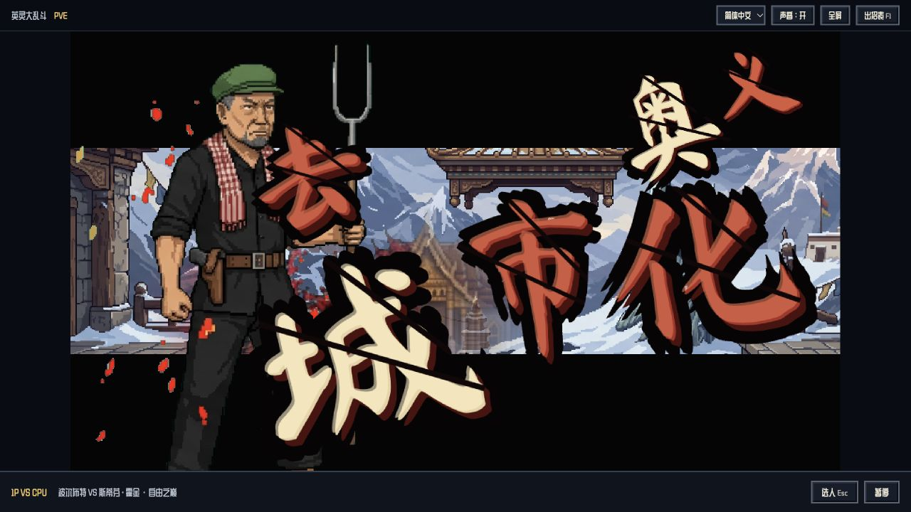
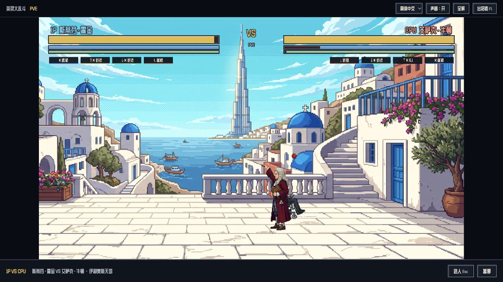
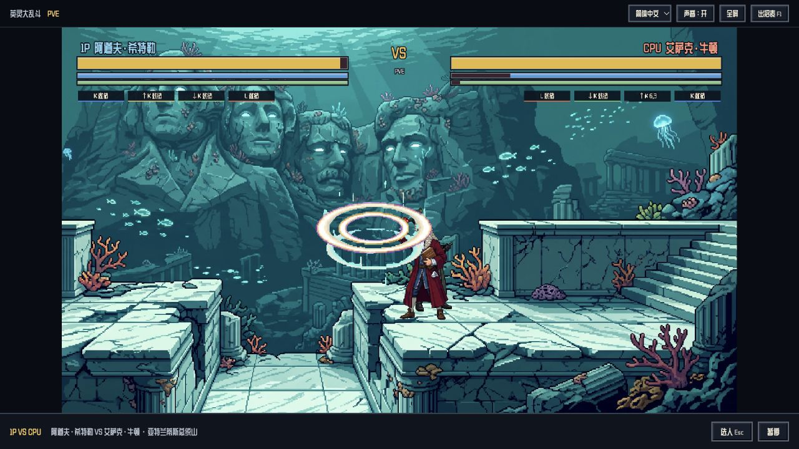
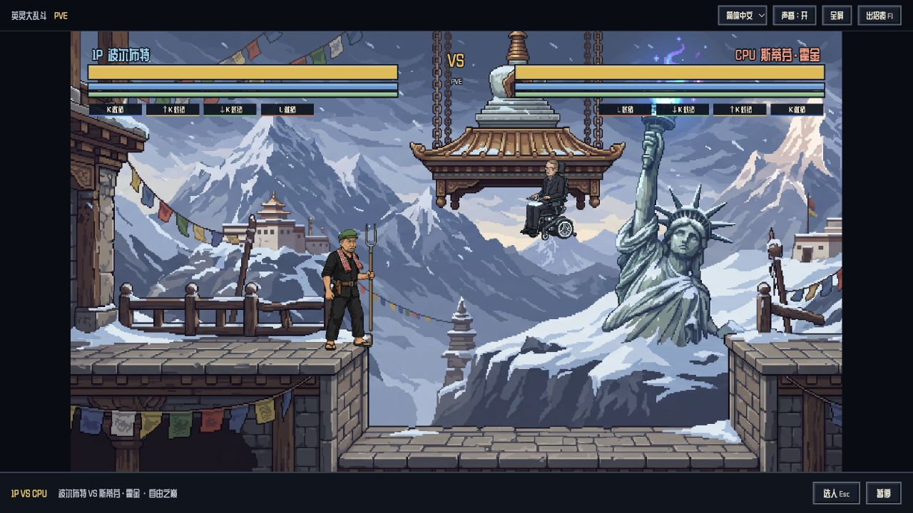

# 英灵大乱斗 · PVE 街机版

[English](README.md) | [日本語](README.ja.md) | **简体中文**

基于 Phaser 3、浏览器点开即玩的像素格斗游戏。选择英灵与战场，在经典街机界面中挑战 CPU。

- 玩家对 CPU 的 PVE 格斗，支持三档难度和同角色对战。
- 中文 / English / 日本語界面即时切换并记住偏好。
- 可导入套图工坊导出的英灵与地图资源包。

**[▶ 网页点开即玩](https://jayson-sheyue.github.io/herogame/)** —— 无需安装、注册或运行命令。选好英灵，按 **J / Enter** 或点击 **开战**。需要电脑实体键盘，当前没有触屏战斗控件。

## 游戏截图

以下均为实际运行画面，使用中文界面与中文奥义字效。点击图片可查看原尺寸。

**经典街机选人：** 选择双方英灵、预览战场，并在开战前设置 CPU 难度。



### 小技能 · K

**牛顿 · 光谱射线 — 伊利奥斯天塔**



### 奥义 · L

巨幅字效斜向贯穿人物与战场，奥义截图采用整宽展示。

**霍金 · 奇点演说**



**希特勒 · 铁十字之辉**



**波尔布特 · 去城市化**



### 像素战场

| 伊利奥斯天塔 | 亚特兰蒂斯总统山 | 自由之巅 |
| --- | --- | --- |
|  |  |  |

## 本地运行（可选）

需要 Python 3.11+ 和桌面浏览器，无需安装 Python 或 npm 依赖。

```bash
git clone https://github.com/jayson-sheyue/herogame.git
cd herogame
python3 game/serve.py
```

打开 <http://127.0.0.1:8788>，按 `Ctrl+C` 停服。默认仅监听本机；自定义端口使用 `--port 8790`。Phaser 3.80.1 已随项目提供，无需连接第三方 CDN。推荐实体键盘与横屏，当前没有触屏战斗按键。

## 网页发布

推送到 `main` 后，工作流会执行检查、构建静态游戏并自动部署到 GitHub Pages，同时提供可上传到 itch.io 的 HTML5 ZIP。构建、预览与上传方法见[网页发布指南](docs/WEB-PUBLISHING.zh-CN.md)。

## 系统语言

顶部语言框可以选择 **自动（默认）/ 简体中文 / English / 日本語**。自动模式按浏览器语言偏好的顺序匹配：中文各地区版本使用简体中文，英文各地区版本使用英文，日语各地区版本使用日文；没有支持的语言或无法读取语言信息时使用英文。浏览器语言通常跟随设备，也可能由浏览器设置单独指定。

已有的手动语言选择会保留并优先恢复；选回 **自动** 即可重新跟随浏览器，页面打开期间浏览器语言偏好发生变化也会同步更新。自动检测不会保存为手动偏好。切换立即更新菜单、出招表、加载 / 错误提示、内置英灵、地图与奥义名称，保留当前选人、地图、难度和对局。

奥义演出按所选语言绘制刀刻字效：中文使用“奥义”与中文招名，英文使用 `SUPER` 与英文招名。演出中切换语言会立即重绘文字，不重启招式。日文奥义使用日文招名与随包笔刷字体。原有语音及导入图片中烘焙的文字不变。自定义资源包可在 `fighter.json` / `stage.json` 提供 `displayNameEn` 或 `i18n.en.displayName`；日语可提供 `displayNameJa` 或 `i18n.ja.displayName`；缺少译名时保留作者原名，切换不会修改资源文件。浏览器不允许存储时，语言选择仅在当前页面会话生效。

## 选人和开战

- 点击左侧 **1P** 或右侧 **CPU** 立绘切换选择对象，再点中间头像。也可用 `W` / `S` 切换对象，`A` / `D` 换人。
- 地图左右箭头或 `←` / `→` 换图。**当前显示的地图就是本局战场**，无需锁定或抽签。
- 点击“初级 / 标准 / 高手”，或用 `F` 循环切换 CPU 难度。
- 点击“开战”，或按 `J` / `Enter` 开始。允许选择相同英灵。

角色与地图选择会保留到返回选人，并写入当前页面地址；`?p1=`、`?p2=`、`?stage=`、`?diff=` 可以预选。旧的 `mode` / `room` 参数会被移除。难度和静音偏好保存在本机浏览器。

## 战斗

| 操作 | 按键 |
| --- | --- |
| 移动 / 跳跃（含二段跳） / 防守 | `A D` / `W` / `S` |
| 冲刺；受击时闪避脱战 | `Shift` |
| 普攻 / 对空普攻 / 对地普攻 | `J` / `W+J` / `S+J` |
| 技能 / 对空技能 / 对地技能 | `K` / `W+K` / `S+K` |
| 奥义；倒地或被控时挣脱 | `L` |
| 返回选人 | `Esc` |
| 结算后同人同图再战 | `J` / `Enter`，或“再战”按钮 |

金色槽为生命，蓝色槽为能量，绿色槽为体力。技能消耗能量；普攻、冲刺、挣脱消耗体力。技能栏显示冷却，中文显示“就绪”，英文显示 `READY`。击倒对方即获胜。

顶部提供声音、全屏与出招表（`F1`）；底部可以暂停。打开出招表或切出窗口会暂停战斗与冷却，关闭说明或点击“继续对战”恢复。加载失败会提供重试或返回选人入口。

## 资源包

支持 [套图工坊](https://github.com/jayson-sheyue/herogame-studio) 导出的 `.hgpk.zip`：

```bash
python3 game/serve.py --import /path/to/hero.hgpk.zip
python3 game/serve.py --assets /path/to/assets/game
python3 game/import_pack.py /path/to/hero.hgpk.zip
```

也可把包放入 `game/incoming/`，启动时自动导入，成功后移至 `_done/`。同 id 的资源会被覆盖。已有页面导入后刷新以更新名单。`--no-incoming` 跳过自动导入。

## 目录与开发检查

- `game/src/game.js`：选人、加载与 PVE 战斗。
- `game/src/i18n.js`：中英日译文、显示名称与语言偏好。
- `game/src/shell.js`、`game/src/ui.css`：街机外框、出招表、暂停与恢复。
- `game/serve.py`：标准库 HTTP 静态服务。
- `assets/game/`：人物、地图与音效；`game/fonts/`：字体。

检查另需 Node.js 22+，无需 npm 安装：

```bash
python3 game/check.py
```

验证范围与实际验收记录见 [测试说明](game/tests/README.zh-CN.md)。运行游戏本身无需 Node.js。

端口占用时用 `--port` 换端口；选人为空时检查 `assets/game/index.json` 和对应人物、地图文件。不要直接双击 `index.html`；页面会引导至默认本机服务器。

请勿提交导入包、`_bak/`、本机配置、凭据或构建缓存。源码采用 [MIT License](LICENSE)，随包字体保留[各自的许可证](game/fonts/README.md)。
